I design, build and run software end to end: C# and .NET services on Azure, the SQL underneath them down to the stored procedure, lakehouse platforms on Microsoft Fabric, the AI agents on top, and the CI/CD that ships all of it.

<a href="https://klyrova.app">
  <picture>
    <source media="(prefers-color-scheme: dark)" srcset="assets/klyrova-dark.svg">
    
  </picture>
</a>

**Also live:** [Dermino AI](https://derminoai.netlify.app), a multimodal vision product where the hardest problem was making sure nobody mistakes it for a diagnosis.

<picture>
  <source media="(prefers-color-scheme: dark)" srcset="assets/release-dark.svg">
  
</picture>

<picture>
  <source media="(prefers-color-scheme: dark)" srcset="assets/stack-dark.svg">
  
</picture>

  <a href="https://rohithmuddaraboina.com">rohithmuddaraboina.com</a> ·
  <a href="https://klyrova.app">klyrova.app</a> ·
  <a href="https://www.linkedin.com/in/rohitchandramuddaraboina">LinkedIn</a>

